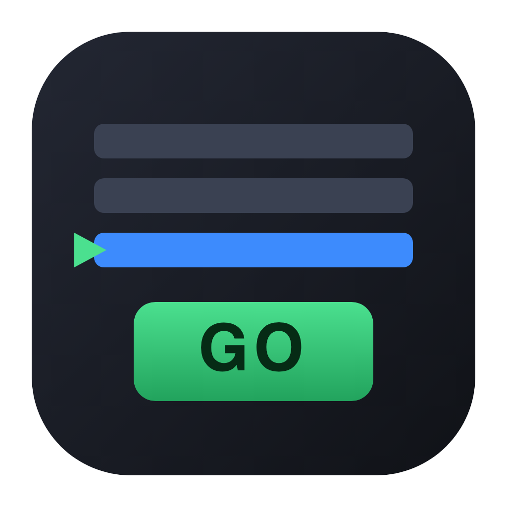

# NomadCue

<p align="center"></p>

**Free, open-source, cross-platform show control for theatre, live events and installations.**
Audio, video, lighting, OSC, MIDI, timecode, scripting and a phone remote. Every feature is included, with no licences, tiers or limits.

Build a list of cues, press **GO**, and NomadCue runs your show: sound, projection, lights and network commands, all timed and linked together. It runs on **macOS, Windows and Linux**.

---

## Everything included, free

| Area | NomadCue |
|---|---|
| Audio outputs | As many channels as your audio interface exposes |
| Channels per audio file | Any; full crosspoint routing matrix per cue |
| Audio fades | Level, per-output level and playback-rate fades with 5 curve shapes |
| Audio effects | High/low-pass filters, 3-band EQ, compressor, delay, reverb on every cue |
| Editing | Waveform view, slices (start/end points), unlimited or counted loops |
| Live input | Mic cues with effects and routing |
| Video outputs | Unlimited stages on any display, windowed or fullscreen |
| Video looks | Opacity, position, scale, rotation, 16 blend modes, layering |
| Video effects | Blur, brightness, contrast, saturation, hue, grayscale, invert, sepia |
| Projection tools | Crop/masking, corner-pin keystone warp, edge blending |
| Live video & titles | Camera cues and text cues |
| Lighting | Unlimited DMX addresses and universes over Art-Net and sACN (E1.31) |
| Lighting tools | Light dashboard, text command language, groups, RGB/RGBW/moving-head instruments |
| Remote control | OSC (UDP 53000), plain-text UDP, MIDI, MIDI Show Control |
| Outgoing control | Network (OSC/UDP), MIDI, MIDI File and MIDI Timecode cues |
| Phone remote | Built-in web remote for any phone, tablet or laptop browser |
| Organisation | Unlimited cue lists and cart (sound-pad) grids |
| Logic | Pause, Devamp, Target, Arm/Disarm, GoTo and JavaScript Script cues |
| Safety | Timestamped backups on every save, autosave, double-GO protection, show mode |
| Platforms | macOS (Intel & Apple Silicon), Windows, Linux |

Not implemented yet: multi-machine collaboration, NDI/Syphon I/O, object/spatial audio, LTC timecode, Stream Deck plugin. Contributions welcome.

---

## Features

### Cue types (25)
Audio · Mic · Video (and still images) · Camera · Text · Light · Fade · Network · MIDI · MIDI File · Timecode · Group · Start · Stop · Pause · Load · Reset · Devamp · GoTo · Target · Arm · Disarm · Wait · Memo · Script

### Show-running
- **GO** (Space) plays the cue under the playhead and moves to the next one. Click any cue, even one inside a group, to put the playhead there. Space works even after you've clicked a button or dropdown; it only types a space while you're in a text field.
- **Panic** (Esc fades everything out; press Esc twice to hard stop), Pause/Resume all, Reset.
- The playhead jumps over auto-continue/auto-follow sequences, as you'd expect.
- Pre-wait, post-wait, **auto-continue** and **auto-follow**. Pausing freezes waits as well as media.
- Groups can **step through their children one GO at a time**, start their first child (which then chains), start all children at once, or start a random child.
- Re-trigger policy per cue: ignore, restart, stop, or pause/resume.
- Double-GO protection, **Show Mode** (locks editing), live progress and time remaining, Active Cues panel.
- **Carts:** grid pads for SFX, with per-cue hotkeys.

### Editing
- **Right-click any cue** for everything in one place: play/stop, add a cue after it or inside a group, paste, transition ("Then"), pre-wait and post-wait presets, fades, move up/down, move into or out of a group, move to another list, colour, arm/flag, rename, duplicate, copy/cut and delete. Right-click empty space to add cues or media.
- **Transitions made simple.** Every cue has a **Then** column you can click:
  - *Wait for GO*: the next cue waits for you to press GO.
  - *Start next with this* (auto-continue): the next cue starts after the post-wait, counted from when this cue starts. A post-wait of 0 starts them together.
  - *Start next when done* (auto-follow): the next cue starts when this one finishes.

  Linked cues are joined by a line, so you can see sequences at a glance. A ⚠ warns you when *Start next when done* can never fire because the cue never ends on its own (text held until stopped, a looping sound, a camera…). In that case GO moves on to the next cue instead.
- **Double-click Pre-wait or Post-wait** in the list to type a time. Setting a post-wait switches the cue to auto-continue automatically.
- The Inspector's **Timing & transition** section shows a timeline and a plain-English summary, e.g. *"GO starts 'Thunder' immediately. 2 s after it starts, 'Lights' starts automatically."*
- **One-click fades:** *Add fade-out after* and *Crossfade into next cue*. One GO fades the current cue out while the next fades in.
- Drag and drop media files to create cues. Drag cues to reorder them, onto the middle of a group to put them inside, or onto another list. Groups show a **+ add inside** button on hover.
- Multi-select editing, undo/redo, copy/cut/paste cues, duplicate, group the selection (⌘G), renumber, move with ⌥↑/⌥↓.
- Missing media and broken targets are flagged ⚠.
- **Bundle Workspace** copies all media next to the workspace. Paths are saved relative to the workspace, so the whole folder moves between machines.

### Control
- **OSC** in on UDP 53000, with replies on 53001. **Plain-text UDP** on 53535.
- **MIDI** triggers per cue (with MIDI Learn), plus global GO/Panic notes. **MIDI Show Control** receive and send.
- **Web remote:** open `http://<your-ip>:53100` on any device for GO, Panic, playhead control, firing cues and running times. Optional passcode.

#### OSC quick reference
```
/go  /go/{number}  /stop  /hardStop  /panic  /panicInTime {s}  /pause  /resume  /reset
/playhead/next  /playhead/previous  /playhead/{number}  /select/{number}
/cue/{number}/start|stop|pause|resume|togglePause|load|arm|disarm
/cue/{number}/name [value]   /cue/selected/start   /cue/playhead/start
/cueLists  /runningCues  /version  /connect {passcode}
(optional prefix: /workspace/{name})
```

### Lighting command language
```
front = 75            # by name
1 thru 6 = full       # ranges, full = 100, out = 0
1 + 3 + 5 = 40        # lists
wash.red = 100        # single parameter
wash.color = #ff8800  # colour for RGB(W) fixtures
all = out
```
You can also build a look on the Light Dashboard and record it into a cue with one click.

### Script cues
```js
nq.log('Starting act 2');
nq.start('12');                       // fire cue 12
await nq.wait(2.5);
nq.osc('192.168.1.20', 8000, '/eos/cue/1/5/fire');
nq.light('front = 40', 3);            // 3-second lighting fade
if (!nq.isRunning('1')) nq.go();
```

---

## Install

### Download
Pre-built installers for macOS (`.dmg`, Intel and Apple Silicon), Windows (`.exe` installer or portable) and Linux (`.AppImage`, `.deb`) are attached to each [GitHub Release](https://github.com/faridmasjedi/NomadCue/releases/latest). The builds are unsigned:
- **macOS:** right-click the app, choose **Open**, then confirm (first launch only).
- **Windows:** SmartScreen → **More info** → **Run anyway**.

### Run from source
```bash
git clone https://github.com/faridmasjedi/NomadCue.git
cd NomadCue
npm install
npm start
```

### Build installers yourself
```bash
npm run dist:mac     # or dist:win / dist:linux
```

## Contributing
`main` is protected: every change goes through a pull request, CI must pass, and the code owner reviews it.

1. Fork, or create a branch: `git checkout -b feature/my-change`
2. Make your change and run the checks locally (below).
3. Open a pull request against `main`.

### Releasing (maintainer)
Bump `version` in `package.json` through a PR, then tag the merged commit:
```bash
git tag v0.2.0 && git push origin v0.2.0
```
The **Release** workflow builds macOS, Windows and Linux installers and publishes them as a GitHub Release.

## Development
```bash
npm test        # unit tests: engine, OSC, DMX packets, lighting language, MIDI files, model
npm run smoke   # launches the real app headless and runs a 39-step end-to-end self-test
```

Project layout:
```
src/main/       Electron main: windows, media:// protocol, OSC/UDP, Art-Net/sACN, web remote, files
src/renderer/   UI + engines (audio.js, video.js, lighting.js, midi.js, cues.js)
src/renderer/lib  pure logic: cue engine, data model, lighting language, MIDI file parser, keystone math
src/stage/      video output window
src/remote/     phone web remote
test/           node:test unit tests
```

## Keyboard shortcuts
| Key | Action |
|---|---|
| Space | GO |
| Esc | Panic (press twice: hard stop) |
| ↑ / ↓ | Move selection (playhead in Show Mode) |
| ⌘1–⌘9, ⌘0 | New Audio, Mic, Video, Camera, Text, Light, Fade, Network, MIDI, Group |
| ⌘D / ⌘G | Duplicate / Group selection |
| ⌘C / ⌘X / ⌘V | Copy / Cut / Paste cues |
| ⌥↑ / ⌥↓ | Move cue up / down |
| Right-click | Cue menu |
| P / S / V | Pause, Stop, Audition selected |
| Enter | Rename selected cue |
| ⌘Z / ⌘⇧Z | Undo / Redo |
| ⌘, | Workspace settings |
| ⌘⇧L | Light dashboard |

## License
MIT. Free for any use, commercial or not.
